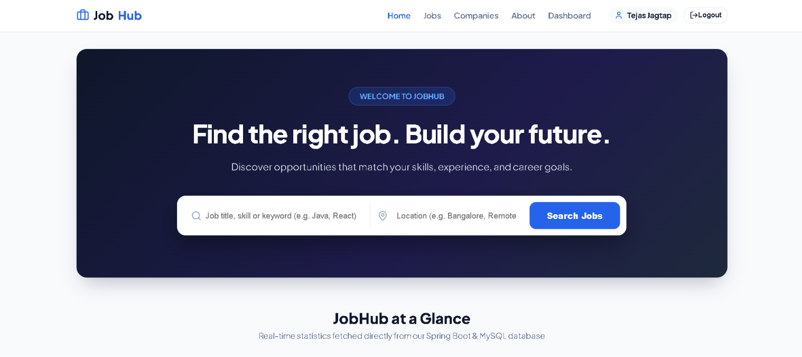
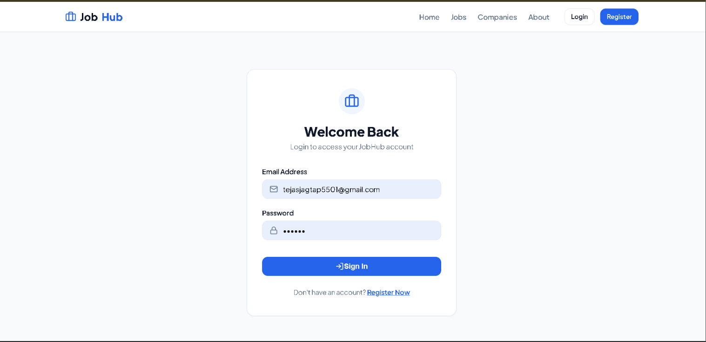
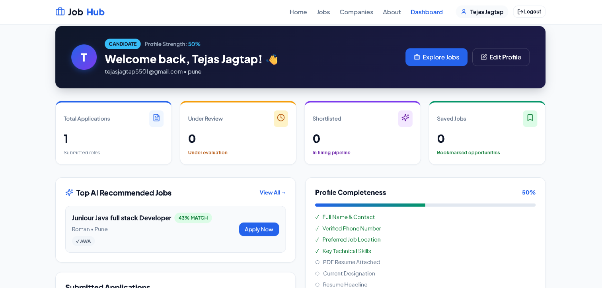
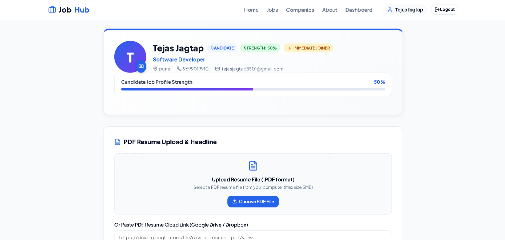

# 💼 JobHub — Full-Stack Job Portal & AI Candidate Recommendation System

<div align="center">

### 👋 Hi, I'm **Tejas Jagtap** — Software Developer

[](https://github.com/TejasJagtap5501)
[](mailto:tejasjagtap5501@gmail.com)
[](tel:+919699019910)


</div>

---

## 👨‍💻 About Me


I'm **Tejas Jagtap**, a **Software Developer** from **Pune, Maharashtra, India**, focused on building full-stack web applications with **Java, Spring Boot, MySQL and React.js**.

**JobHub** is my flagship full-stack project — a production-style job portal where candidates search and apply for real roles, recruiters post jobs and manage applicants, and an **AI-style recommendation engine** computes match percentages between a candidate's skills and a job's requirements.

- 🔭 **Currently working on:** Full-stack Java + React applications and REST API design
- 🌱 **Learning & sharpening:** Spring Security (JWT), Hibernate/JPA, clean architecture, DSA
- 🤝 **Open to:** Full-time **Software Developer / Java Backend / Full-Stack** roles
- ⚡ **Availability:** Immediate joiner, based in Pune
- 📫 **Reach me:** [tejasjagtap5501@gmail.com](mailto:tejasjagtap5501@gmail.com) · +91 96990 19910
- 🐙 **GitHub:** [@TejasJagtap5501](https://github.com/TejasJagtap5501)

<br clear="right" />

| | |
| :--- | :--- |
| **Name** | Tejas Jagtap |
| **Role** | Software Developer |
| **Location** | Pune, Maharashtra, India |
| **Email** | tejasjagtap5501@gmail.com |
| **Phone** | +91 96990 19910 |
| **GitHub** | [github.com/TejasJagtap5501](https://github.com/TejasJagtap5501) |
| **Repository** | [Job-Appication-Portal](https://github.com/TejasJagtap5501/Job-Appication-Portal) |
| **Availability** | Immediate Joiner · Open to full-time roles |

---

## 📸 Application Screenshots

### 🏠 Home — Search jobs from a live Spring Boot + MySQL backend


### 🔐 Secure Login — Stateless JWT authentication with BCrypt password hashing


### 📊 Candidate Dashboard — Live application stats, AI recommended jobs & profile completeness


### 📄 Candidate Profile — PDF resume upload, headline & profile strength meter


---

## 🚀 Tech Stack

<div align="center">


</div>

### ⚙️ Backend
| Layer | Technology |
| :--- | :--- |
| Language | **Java 21** |
| Framework | **Spring Boot** (Spring Web, Spring Data JPA, Hibernate ORM, Bean Validation) |
| Security | **Spring Security**, stateless **JWT Bearer tokens**, **BCrypt** password hashing, role-based access (`CANDIDATE`, `RECRUITER`, `ADMIN`) |
| Database | **MySQL 8** with HikariCP connection pooling |
| Search & Filtering | Spring Data JPA **Specifications** + paginated `Page<Job>` responses |
| Build & Deploy | Maven, multi-stage **Docker** image (Eclipse Temurin JRE) |

### 🎨 Frontend
| Layer | Technology |
| :--- | :--- |
| Library | **React 18** |
| Build tool | **Vite 6** |
| Routing | **React Router 7** (SPA with protected routes) |
| HTTP client | **Axios** with request/response interceptors (auto JWT attach) |
| State | React Context (`AuthContext`) + `localStorage` session persistence |
| UI | Custom responsive **CSS3** (design tokens, flex/grid) + **Lucide React** icons |

### 🤖 Recommendation Engine
- **Service:** `AiRecommendationService.java` (exposed via `/api/ai/recommendations`)
- **Skill tokenization:** splits and normalizes comma/`;`/`/`-separated skills into canonical sets
- **Match scoring:** `matched skills / required skills × 100`, with a **+10% location boost** when candidate and job locations align
- **Skill gap insights:** set difference between job skills and candidate skills, returned as suggested learning items
- **Extensible AI hook:** pluggable `ai.api.key` slot for an external LLM/Gemini-compatible engine, with automatic fallback to the deterministic rule-based scorer if no key is set or the call fails

---

## ✨ Features

### 👨‍💻 Candidate Experience
- **JWT authentication** — register, login, and role-aware protected routes
- **Real-time job search** — keyword, location, job type (*FULL_TIME, PART_TIME, INTERNSHIP, CONTRACT*), salary and skills filters with pagination & sorting
- **AI match score per job** — dynamic match percentage with matching and missing skill breakdown
- **Apply with cover letter** — duplicate-application protection and instant status tracking
- **Application pipeline tracking** — *APPLIED ➔ REVIEWING ➔ SHORTLISTED ➔ SELECTED / REJECTED*
- **Candidate dashboard** — total applications, under review, shortlisted, saved jobs, recent applications, top AI recommended jobs and a **profile completeness meter**
- **Rich profile** — PDF resume upload or cloud resume link, headline, designation, skills, experience, education, expected CTC, notice period, LinkedIn/GitHub/portfolio links
- **Saved jobs** — bookmark and revisit opportunities

### 🏢 Recruiter Experience
- **Company management** — logo, industry, website, location, employee size, founded year
- **Job posting & editing** — publish and maintain openings with full skill requirements
- **Applicant inspection** — review profiles, cover letters, and open PDF resumes in one click
- **Live status updates** — move applicants through the hiring pipeline
- **Recruiter dashboard** — posted jobs, applications received, active candidates and hiring stats

### 🔒 Platform & Engineering
- Stateless JWT security filter chain with BCrypt hashing and CORS configuration
- Centralized exception handling (`GlobalExceptionHandler`) with consistent `ApiResponse` envelopes
- DTO ↔ Entity mapping to keep JPA entities out of the API surface
- Response compression, HikariCP tuning and batched JPA writes for fast payloads
- Keep-alive scheduler for free-tier cloud hosting
- Fully responsive UI (mobile → desktop)

---

## 🧠 How the Match Score Works

```
Candidate skills : Java, Spring Boot, MySQL, React
Job requires     : Java, Spring Boot, MySQL, Docker

matched  = 3   →  3 / 4 = 75%
location = Pune (candidate) ~ Pune (job)  →  +10% boost
final match score = 85%
missing skill     →  Docker  (returned as a learning suggestion)
```

Recommendations are sorted by match percentage descending and returned with a human-readable reason string, so the dashboard can explain *why* a job was suggested.

---

## 📂 Project Structure

```
Job-Appication-Portal/
├── backend/                              # Java Spring Boot REST API
│   ├── src/main/java/com/jobhub/jobhub/
│   │   ├── config/                      # SecurityConfig (JWT + CORS)
│   │   ├── controller/                  # Auth, Job, Company, Application, AI, Dashboard, User, SavedJob
│   │   ├── dto/                         # Request / Response / Dashboard DTOs
│   │   ├── entity/                      # User, Job, Company, Application, SavedJob + enums
│   │   ├── exception/                   # GlobalExceptionHandler & custom exceptions
│   │   ├── repository/                  # Spring Data JPA repositories
│   │   ├── scheduler/                   # KeepAliveScheduler
│   │   ├── security/                    # JwtService, JwtAuthenticationFilter, UserDetails
│   │   ├── service/                     # Business logic + AiRecommendationService
│   │   └── specification/               # Dynamic JobSpecification filters
│   ├── src/main/resources/              # application.properties
│   ├── pom.xml                          # Maven build
│   └── Dockerfile                       # Multi-stage container build
│
├── frontend/                             # React + Vite SPA
│   ├── src/
│   │   ├── components/                  # Navbar, JobCard, JobFilters, SearchBar, hero sections...
│   │   ├── context/                     # AuthContext
│   │   ├── pages/                       # Home, Jobs, JobDetails, Companies, About, Dashboard, Profile...
│   │   ├── services/                    # Axios API layer (JWT interceptor)
│   │   ├── App.jsx                      # Routes & protected route guards
│   │   └── index.css                    # Design tokens & responsive styles
│   ├── package.json
│   └── vercel.json                      # SPA rewrites
│
├── screenshots/                          # Application screenshots used in this README
├── render.yaml                           # Backend deployment blueprint
├── vercel.json                           # Frontend deployment config
└── README.md
```

---

## 🔌 REST API Reference

| Category | Method | Endpoint | Access |
| :--- | :--- | :--- | :--- |
| **Auth** | `POST` | `/api/auth/register` | Public |
| **Auth** | `POST` | `/api/auth/login` | Public |
| **Home** | `GET` | `/api/home/ping` | Public |
| **Home** | `GET` | `/api/home/stats` | Public |
| **Jobs** | `GET` | `/api/jobs/search` | Public |
| **Jobs** | `GET` | `/api/jobs` | Public |
| **Jobs** | `GET` | `/api/jobs/latest` | Public |
| **Jobs** | `GET` | `/api/jobs/categories` | Public |
| **Jobs** | `GET` | `/api/jobs/{id}` | Public |
| **Jobs** | `POST` | `/api/jobs` | Recruiter |
| **Jobs** | `GET` | `/api/jobs/recruiter/{recruiterId}` | Recruiter |
| **Jobs** | `PUT` | `/api/jobs/{id}` | Recruiter |
| **Jobs** | `DELETE` | `/api/jobs/{id}` | Recruiter |
| **Companies** | `GET` | `/api/companies`, `/api/companies/search`, `/api/companies/stats` | Public |
| **Companies** | `GET` | `/api/companies/{id}`, `/api/companies/{id}/jobs` | Public |
| **Companies** | `POST` | `/api/companies` | Recruiter |
| **Companies** | `DELETE` | `/api/companies/{id}` | Recruiter |
| **AI** | `GET` | `/api/ai/recommendations` | Candidate |
| **Applications** | `POST` | `/api/applications` | Candidate |
| **Applications** | `GET` | `/api/applications/my` | Candidate |
| **Applications** | `GET` | `/api/applications/{id}` | Owner / Recruiter |
| **Applications** | `GET` | `/api/applications/job/{jobId}` | Recruiter |
| **Applications** | `PUT` | `/api/applications/{id}/status` | Recruiter |
| **Applications** | `DELETE` | `/api/applications/{id}` | Candidate |
| **Saved Jobs** | `POST` / `DELETE` | `/api/saved-jobs/{jobId}` | Candidate |
| **Saved Jobs** | `GET` | `/api/saved-jobs` | Candidate |
| **Dashboard** | `GET` | `/api/dashboard/candidate` | Candidate |
| **Dashboard** | `GET` | `/api/dashboard/recruiter` | Recruiter |
| **Users** | `GET` / `PUT` / `DELETE` | `/api/users/{id}` | Authenticated |

---

## 🛠️ Run Locally

### Prerequisites
- **Java 21+** and Maven
- **Node.js 18+**
- **MySQL 8**

### 1. Database
```sql
CREATE DATABASE jobhub_db;
```

### 2. Backend (Spring Boot — port 8080)
```bash
cd backend
```

Create/update `src/main/resources/application.properties`:
```properties
spring.datasource.url=jdbc:mysql://localhost:3306/jobhub_db
spring.datasource.username=root
spring.datasource.password=YOUR_MYSQL_PASSWORD

jwt.secret=YOUR_LONG_RANDOM_SECRET
jwt.expiration=86400000
```

Then run:
```bash
./mvnw spring-boot:run
```

### 3. Frontend (React + Vite — port 5173)
```bash
cd frontend
npm install
npm run dev
```

Optional `frontend/.env` to point at a different API:
```bash
VITE_API_BASE_URL=http://localhost:8080/api
```

Open **http://localhost:5173** and register as a **Candidate** or **Recruiter**.

---

## 🚀 Deployment

| Layer | Platform | Config |
| :--- | :--- | :--- |
| Frontend | **Vercel** | `vercel.json` — build `frontend`, output `frontend/dist`, SPA rewrites |
| Backend | **Render / Railway (Docker)** | `render.yaml` + `backend/Dockerfile` |
| Database | **Managed MySQL** | Set `spring.datasource.*` env vars on the host |

**Environment variables to set on the backend host**

| Variable | Purpose |
| :--- | :--- |
| `JWT_SECRET` | Signing key for JWT tokens |
| `AI_API_KEY` | Optional key for an external LLM recommendation engine |
| `SPRING_DATASOURCE_URL` / `USERNAME` / `PASSWORD` | Database connection |
| `PORT` | Server port (default `8080`) |

---

## 📄 Resume Bullets (Project Summary)

> **JobHub — Full-Stack Job Portal & AI Candidate Recommendation System** — [GitHub](https://github.com/TejasJagtap5501/Job-Appication-Portal)  
> **Tech Stack:** Java 21, Spring Boot, Spring Security (JWT), Spring Data JPA, Hibernate, MySQL 8, React 18, Vite, React Router 7, Axios, Docker
>
> - **Built** a full-stack job portal with separate **Candidate** and **Recruiter** workflows, stateless **JWT authentication**, **BCrypt** password hashing and role-based route protection across 15+ REST endpoints.
> - **Implemented** a recommendation engine (`AiRecommendationService`) that tokenizes and normalizes skills, scores jobs with a Jaccard-style skill-overlap formula plus a location boost, and returns skill-gap suggestions with human-readable match reasons.
> - **Developed** multi-criteria job search (keyword, location, type, salary, skills) using **Spring Data JPA Specifications** with paginated `Page<Job>` responses and client-side sorting.
> - **Designed** a candidate application lifecycle (*APPLIED ➔ REVIEWING ➔ SHORTLISTED ➔ SELECTED / REJECTED*) with duplicate-application guards, saved-job bookmarks and 1-click recruiter PDF resume inspection.
> - **Engineered** responsive React dashboards consuming Axios services with JWT interceptors, backed by HikariCP pooling, response compression and centralized exception handling.

---

## 🙏 Acknowledgements

This repository is my personal portfolio build of the **JobHub** concept, originally created by [Nitish Pathak](https://github.com/nitishkpathak). I've adapted, extended and documented it as part of my own full-stack learning and portfolio work.

---

## 📜 License

Released under the [MIT License](LICENSE).

---

<div align="center">

**Built with ❤️ by Tejas Jagtap** · Pune, India

[](https://github.com/TejasJagtap5501)
[](mailto:tejasjagtap5501@gmail.com)

⭐ If you like this project, consider giving it a star!

</div>
